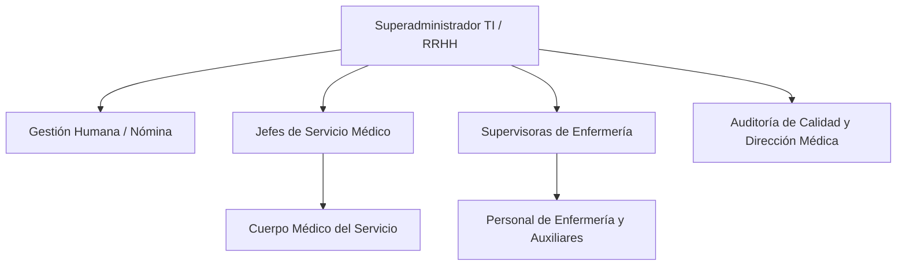

# 11. Matriz de Roles, Permisos y Seguridad (RBAC Hospitalario)

## 1. Principio de Mínimo Privilegio en el Entorno Hospitalario
En una institución de salud, los permisos deben ser altamente granulares y segmentados por **Dependencia / Servicio**: una supervisora de Urgencias no debe poder modificar el cuadrante de Quirófano, y un médico especialista no debe tener acceso a alterar cuadrantes ajenos.

---

## 2. Definición de Roles del Sistema

1. **Superadministrador (TI / Dirección RRHH)**:
   - Control total de la plataforma.
   - Configuración de conexión con la Intranet (SSO y endpoints).
   - Parametrización global de tipos de turnos y convenios legales.
2. **Gestión Humana / Especialista de Nómina**:
   - Visibilidad consolidada de todos los servicios hospitalarios.
   - Gestión y auditoría de la bolsa de horas y recargos.
   - Autoridad exclusiva para ejecutar el **Cierre Mensual** y exportar a nómina.
3. **Jefe de Servicio / Coordinador de Especialidad** (ej. Jefe de UCI o Cirugía):
   - Responsable de la planificación de los facultativos y médicos de su servicio.
   - Valida permutas y coberturas médicas.
4. **Supervisora de Enfermería** (asignada a una o varias dependencias):
   - Diseña y mantiene los cuadrantes de enfermeros jefes, auxiliares y camilleros de sus servicios asignados.
   - Aprueba solicitudes de intercambio y gestiona sustituciones de última hora.
5. **Personal Asistencial (Médicos, Enfermería, Auxiliares)**:
   - Consulta de su cuadrante personal y del cuadrante general de su servicio (para saber con qué compañeros trabaja en cada turno).
   - Propone y acepta permutas de turnos.
   - Solicita permisos o vacaciones.
6. **Auditoría de Calidad / Dirección Médica**:
   - Rol de solo lectura analítica: supervisa el cumplimiento de los estándares de acreditación en salud (ratios mínimos enfermero/paciente y descansos de seguridad).

---

## 3. Matriz Granular de Permisos (CRUD)

| Acción / Módulo | Superadmin | Gestión Humana | Jefe / Supervisora | Personal Asistencial | Auditor Calidad |
|---|:---:|:---:|:---:|:---:|:---:|
| **Crear / Editar Catálogo de Turnos** | ✅ | ✅ | ❌ | ❌ | ❌ |
| **Configurar Coberturas Mínimas** | ✅ | ✅ | ✅ (Su servicio) | ❌ | ❌ |
| **Generar Cuadrante Borrador** | ✅ | ✅ | ✅ (Su servicio) | ❌ | ❌ |
| **Editar Cuadrante (Arrastre / Paleta)**| ✅ | ❌ | ✅ (Su servicio) | ❌ | ❌ |
| **Publicar Cuadrante** | ✅ | ❌ | ✅ (Su servicio) | ❌ | ❌ |
| **Aprobar Permutas / Cambios de Turno**| ✅ | ❌ | ✅ (Su servicio) | ❌ | ❌ |
| **Proponer Permuta 1-a-1** | ❌ | ❌ | ❌ | ✅ (Entre pares) | ❌ |
| **Ver Cuadrante Publicado** | ✅ | ✅ | ✅ | ✅ (Su servicio) | ✅ |
| **Ejecutar Cierre de Mes (Nómina)** | ✅ | ✅ | ❌ | ❌ | ❌ |
| **Modificar Cuadrante Cerrado** | ✅ | ❌ (Solo reapertura) | ❌ | ❌ | ❌ |
| **Exportar Horas y Recargos** | ✅ | ✅ | ✅ (Su servicio) | ❌ | ✅ |
| **Ver Bitácora Forense de Auditoría** | ✅ | ✅ | ✅ (Su servicio) | ❌ | ✅ |

---

## 4. Seguridad y Protección de Datos en Salud (Habeas Data)
- **Datos Médicos Sensibles**: Los motivos específicos o diagnósticos (CIE-10) de las incapacidades médicas **solo son visibles para Gestión Humana y Salud Ocupacional**. Para los compañeros y supervisores en el cuadrante, la celda únicamente muestra la etiqueta genérica `INC` (Incapacidad Médica), protegiendo la confidencialidad médica del colaborador.
- **Tokens de Sesión Acotados**: La sesión transferida desde la Intranet incluye en el payload JWT el array de permisos (`permisos: string[]`) y dependencias permitidas (`serviciosCoordinados`), verificado por NestJS mediante `SsoRoleGuard`.

---

## 5. Modelo Oficial Basado en Permisos de la Intranet (4 Permisos Consolidados)

En la integración real con la Intranet Hospitalaria, la autorización se gobierna mediante **4 permisos normalizados y Capitalizados (`PascalCase`)** dentro del payload JWT (`permisos: string[]`), manteniendo retrocompatibilidad con el campo `rol`:

| # | Código de Permiso (Intranet JWT) | Alcance y Capacidades Habilitadas en Rafa Turnos |
|:---:|---|---|
| *(Base)* | *(Implícito para todo empleado)* | **Mi Calendario (`PORTAL_EMPLEADO`):** consultar sus propios turnos, proponer/aceptar permutas 1-a-1, reportar Tiempo Adicional / llamados `DISP` propios y suscripción iCal. |
| **1** | `TurnosCuadranteEditar` | **Planificación y Aprobación del Servicio:** editar el Cuadro de Turnos, rotar apoyos, publicar (`BORRADOR → PUBLICADO`) y **aprobar/rechazar Permutas y Tiempo Adicional / `DISP`** en su Servicio Base, Servicios Hermanos y todos los servicios donde esté designado como **Coordinador del Servicio** (`servicios.coordinadoresIds`). |
| **2** | `TurnosConsultaGlobal` | **Supervisión y Auditoría Global (Solo Lectura):** ver Cuadro de Turnos, Solicitudes, Reportes/CSV y Auditoría de todos los servicios del hospital sin permisos de edición ni cierre. |
| **3** | `TurnosNominaGestionar` | **Cierre y Liquidación de Nómina Global:** incluye `TurnosConsultaGlobal` + autoridad para ejecutar el **Cierre Mensual de Nómina** (`PUBLICADO → CERRADO_NOMINA`), **Reapertura** y visualización de códigos CIE-10. |
| **4** | `TurnosConfiguracionAdmin` | **Administración Global (`GESTIÓN`):** administrar Servicios (incluyendo designar Coordinadores de cada servicio), Personal, Catálogo de Turnos, Empresas Contratantes y Festivos. |
